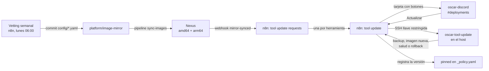

# Actualización de herramientas con aprobación en Discord

**Estado:** Actual (armado 2026-10-12/13, aprobaciones con botones desde 2026-10-15).

Pedido del dueño: *"todas las herramientas siempre actualizadas, con posibilidad de rollback"*, aprobando cada una desde Discord y tomando siempre las imágenes de Nexus.

## Circuito



1. **Vetting** (`OSCAR - image-mirror version vetting`): elige versiones con Skopeo + Trivy y las escribe en `config/<familia>.yaml` de `platform/image-mirror`. Las herramientas (`alwaysLatest`, incluido n8n desde 2026-10-15) se espejan siempre y sus CVE CRITICAL se informan en el aviso; las bases de datos y caches descartan versiones con CRITICAL. Corre solo con `.trivyignore` (no hay listas fijas de excepciones).
2. **Sync**: el pipeline copia las imágenes a Nexus y al terminar llama al webhook `mirror-synced`.
3. **Pedidos** (`OSCAR - tool update requests`): pregunta por SSH qué corre cada host y, para lo que está atrasado, dispara un pedido.
4. **Aprobación** (`OSCAR - tool update (aprobación por Discord)`): el bot [oscar-discord](../servicios/oscar-discord.md) publica la tarjeta con **Actualizar / Omitir** en `#deployments`. Vence a las 24 h.
5. **Ejecución**: al aprobar, n8n entra por SSH al host y corre `oscar-tool-update update <herramienta> <tag>`.
6. **Registro**: si quedó sana, la versión pasa a `pinned` en `config/_policy.yaml` (se guardan las últimas 3), para que el mirror nunca borre de Nexus la imagen en uso.

## El script `oscar-tool-update`

Vive en `/usr/local/sbin/oscar-tool-update` de cada host y está versionado en `apps/gitops`, rol de Ansible `oscar_tool_update` (`ansible-playbook oscar-tool-update.yml`).

- Acciones: `status`, `update <tool> <tag>`, `rollback <tool>`, `list`. La última línea siempre es `RESULT {json}` para que n8n la lea.
- **Allowlist**: solo opera sobre herramientas con archivo en `/etc/oscar-tool-update.d/<tool>.env` (`COMPOSE_DIR`, `SERVICE`, `IMAGE_REPO`, `HEALTH_URL` o `none`, `VOLUMES`, `PATHS`, `STOP_SERVICES`).
- **Update**: baja la imagen de Nexus con el servicio arriba, para lo necesario, hace backup comprimido de volúmenes y rutas, cambia la imagen (en `compose.override.yaml`, nunca toca el `compose.yaml`), espera a que quede sana y, si no, vuelve sola a la versión y los datos anteriores.
- Auditoría en `/var/log/oscar-tool-update.log`; backups en `/srv/oscar/backups/tool-update/<tool>/`.

### Herramientas por host

| Host | Herramientas |
|---|---|
| services (LXC 108, n8n entra como root) | actual, docuseal, karakeep, paperless, searxng, vaultwarden |
| core | cloudflared, homepage, homepagedashboard, myspeed, npm |
| devops | forgejo, forgejorunner, infisical |
| monitor | alertmanager, blackbox, grafana, prometheus, uptimekuma |
| network | cloudflared |

Fuera del circuito a propósito: **n8n** (se cortaría a sí mismo), **Nexus** (el backup no entra en disco), garage, y lo que corre en k3s (Argo CD, Headlamp: va por GitOps).

### Acceso de n8n

Llave SSH `n8n-oscar-tool-update` en `authorized_keys` con `command=` forzado, sin PTY ni forwarding: solo puede correr el script. Donde el usuario no es root, entra por `/usr/local/sbin/oscar-tool-update-ssh`, que eleva únicamente al script (en las Pi con un sudoers de una sola línea). Credenciales en n8n: `SSH - tool-update <host>`. Para bajar de Nexus, cada host tiene `docker login` con el usuario de solo lectura `oscar-pull`.

## Rollback manual

```bash
# en el host, como root
oscar-tool-update rollback <herramienta>
```

## Trampas conocidas

- Republicar un workflow de n8n por API (deactivate/activate) con una ejecución esperando la mata: revisar ejecuciones `waiting`/`running` antes.
- El nodo SSH de n8n antepone `cd / ;` al comando; el script lo tolera.
- El aviso con `sendAndWait` del nodo Discord no funciona con credencial de webhook; por eso primero se usó un formulario y hoy, el bot.
